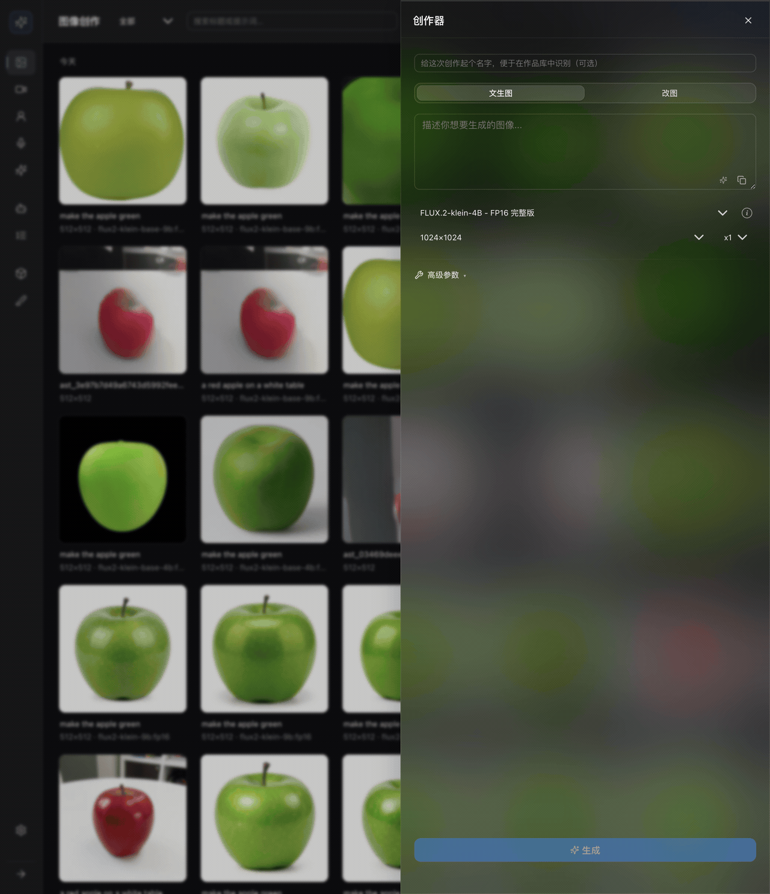
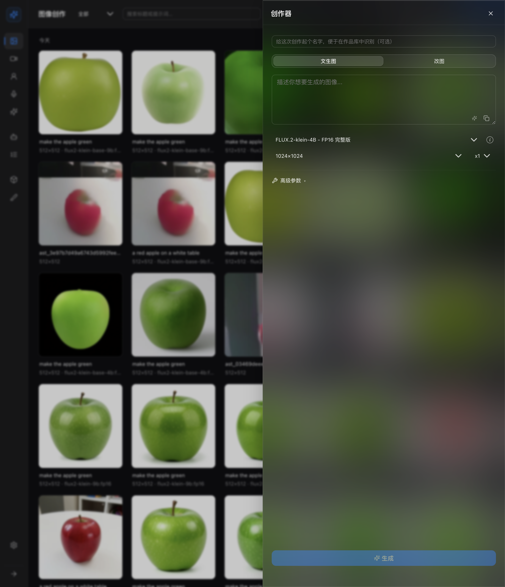
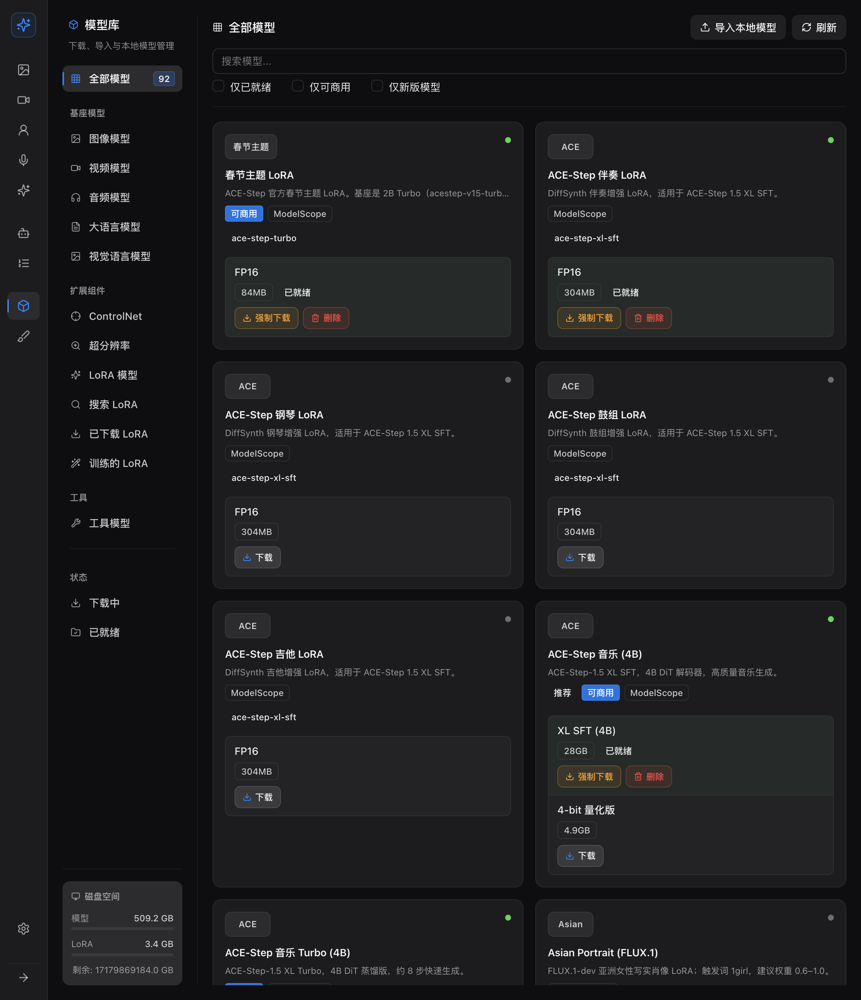
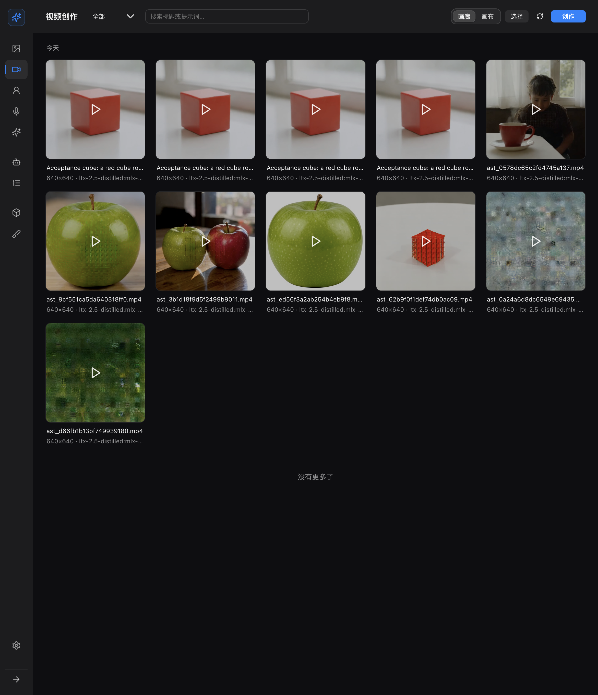

# Danmo Make

Language: **English** | [中文](README_zh.md)

Local **image / video / audio** studio — **Rust + MLX** engine, **Vue 3** UI, **one-click** model registry. Not a node editor: open the app, pick a card, create. Production weights are **safetensors** (`fp16`, `bf16`, `fp32`, `int8`, `int4`, `mlx-q4`, `mlx-q8`) at checkpoint dtype. Missing capabilities **fail loud**.



Studio screenshots (live UI, 2026-11-19) — composer · gallery · canvas · video · registry · audio

|                                                                            |                                                                   |
| :------------------------------------------------------------------------: | :---------------------------------------------------------------: |
|  |  |
|   |                                                                   |

Product name: **Danmo Make**. Runtime ids stay `danqing-`*; CLIs are* `danmo-` ([AGENTS.md](AGENTS.md) → Naming boundary).

---

## Why Rust MLX (vs Python MLX & ComfyUI)

**Rust MLX** stack with a **native Rust** engine (`danqing-api` / `danmo-`* CLI → `danmo-engine` → `danmo-mlx`).  less runtime overhead on Apple Silicon and Linux CUDA.

### Measured vs Python MLX

Apple Silicon Metal unless noted.

|                                            | **Danmo Make（Rust MLX）**                                                                                           | **Python MLX**                                                                                                              |
| ------------------------------------------ | ------------------------------------------------------------------------------------------------------------------ | --------------------------------------------------------------------------------------------------------------------------- |
| **Install / runtime**                      | Single native binary (`danqing-api` **~22 MB** release build); **no** `pip`, **no** `runtime-venv` on first launch | macOS DMG **~318 MB** ([release asset](https://github.com/danmo-ai/danmo-make/releases)); dev `.venv` commonly **~1.2 GB**; |
| **GPU memory (steady active, same model)** | Z-Image Turbo `mlx-q4` **768×1280**: **5.5 GB**                                                                    | **7.0 GB** (**~79%**)                                                                                                       |
|                                            | Z-Image `mlx-q8`: **10.0 GB**                                                                                      | **12.4 GB** (**~88%**)                                                                                                      |
| **Warm latency (p50, observational)**      | Flux2 Klein 4B `mlx-q4` create **1.54s**                                                                           | **2.24s** (**~69%** )                                                                                                       |
|                                            | LTX 2.5 `mlx-q4` create **15.4s**                                                                                  | **17.7s** (**~87%**)                                                                                                        |
| **Process model**                          | One long-lived **MLX executor** thread; compiled VAE decode, resident caches where parity allows                   | Python interpreter + per-request context; extra host churn                                                                  |
| **Training**                               | Rust MLX LoRA trainer                                                                                              |                                                                                                                             |

### Studio product vs ComfyUI

ComfyUI excels at **arbitrary node graphs** and the **custom-node ecosystem**. Danmo Make targets **daily production**: same queue, gallery, canvas, and API for image, video, and audio — without wiring checkpoints by hand.

| | **Danmo Make (Rust MLX)** | **ComfyUI** |
|---|---|---|
| **Who it is for** | Creators who want a **finished studio** (desktop + SPA) | Tinkerers building **bespoke workflows** |
| **UX** | Composer, bilingual registry, global queue, SSE task logs | Node canvas; quality depends on workflow JSON |
| **Model setup** | Registry cards → download/install → create | Manual folders + often custom nodes per model family |
| **Multimodal** | Image / video / audio / LoRA tabs in **one** app | Possible, but you assemble and maintain graphs |
| **Assets** | SQLite gallery, infinite canvas, lineage edges | Typically separate folders / no built-in lineage |
| **Apple Silicon** | **Native MLX Metal** in-process | Usually **PyTorch** (MPS/CUDA) or remote GPU |
| **API** | Contract HTTP + `danmo-`* CLI sharing the engine | REST optional; not the default mental model |
| **Flexibility** | Curated registry actions (`create`, `rewrite`, …); fail loud if unsupported | **Widest** third-party node surface |

**When to pick ComfyUI:** you need a specific community workflow or experimental nodes Danmo has not registered. **When to pick Danmo Make:** you want MLX-native speed, lower runtime footprint, and a product UI that stays in sync with closed-out families (Z-Image, Flux2 Klein, ACE-Step, LTX 2.5 — see [migration matrix](docs/rust_mlx_migration_matrix.json)).

| | |
|---|---|
| **Contributors / coding agents** | [AGENTS.md](AGENTS.md) |
| **Desktop (Tauri 2)** | [desktop/README.md](desktop/README.md) |
| **Engine architecture** | [docs/engine_architecture.md](docs/engine_architecture.md) |
| **Migration status (per model)** | [docs/rust_mlx_migration_matrix.json](docs/rust_mlx_migration_matrix.json) · [todo](docs/rust_mlx_migration_todo.md) |
| **Releases** | [GitHub Releases](https://github.com/danmo-ai/danmo-make/releases) |

---

## Features

- **MLX runtime** — one long-lived executor thread owns generation; `Array`/`Device`/`Stream` are thread-affine. Metal and CUDA are separate build artifacts (`mlx-metal`, `mlx-cuda`); family math never branches on the chip.
- **Safetensors weights** — dense tensors keep checkpoint dtype; affine int4/int8 stay packed in `LinearWeight`. LoRA is a shared residual (`y = Wx + scale·BAx`) for dense and packed linears.
- **Families** — Z-Image (+ ControlNet union) and Flux2 Klein image create/rewrite are closed out on Metal; ACE-Step audio create/cover/repaint/lego/extract/complete runs on MLX; LTX 2.5 two-stage audio-video runs real tasks. Per-model/version/action status: [migration matrix](docs/rust_mlx_migration_matrix.json). Anything unbuilt stays visible and fails before it runs.
- **Contract API** — Vue talks to `danqing-api` (`POST /api/images/generations` and the sibling routes).
- **CLI** — `danmo-generate` / `danmo-edit` / `danmo-audio-generate` / `danmo-audio-edit` / `danmo-video-generate` / `danmo-video-edit` run generation without the HTTP server, sharing the same registry resolution and engine path.
- **LoRA training (in progress)** — Rust MLX trainer with named presets (`turbo-sft` / `turbo-diff` / `base-face`), dataset wizard, and one-command register; currently a probe loop pending the full acceptance gate. There is no Python trainer.
- **Global queue** — One serial worker for image / video / audio; SSE progress, priority, persistent logs.
- **Studio UI** — Vue 3 + Vite + TypeScript + `@danqing/dq-ui`; Create / Gallery / Models / Settings; bilingual registry names.
- **Infinite canvas** — Grid and canvas share one asset library; sessions, lineage edges, staging, composer bindings.
- **Desktop apps** — macOS `.dmg`; Linux desktop / server tar.gz.

---

## Requirements

| Platform | Notes |
|----------|--------|
| **macOS (Apple Silicon)** | MLX Metal (`mlx-metal`) |
| **Linux** | MLX CUDA (`mlx-cuda`; CUDA toolkit only needed to compile) |
| **Rust** | stable toolchain (`rustup`) |
| **RAM** | 32 GB+ recommended for large models |
| **Node.js** | Frontend + desktop packaging |

Missing backends or unsupported actions **fail loudly** — no silent CLI/model fallback.

---

## Install from release (recommended)

Download from [GitHub Releases](https://github.com/danmo-ai/danmo-make/releases). Windows packs are temporarily unsupported.

### macOS (Apple Silicon) — `.dmg`

1. Open the DMG and drag **Danmo Make.app** into Applications.
2. First launch may be blocked (unsigned / quarantine). Prefer **Control-click → Open**, or:

```bash
xattr -dr com.apple.quarantine "/Applications/Danmo Make.app"
```

More detail: [desktop/README.md](desktop/README.md) → quarantine tip.

### Linux (x86_64 + NVIDIA) — thin server `.tar.gz`

CI ships `danmo-make-linux-mlx-cuda-x86_64-<version>.tar.gz` (headless `danqing-api` + built UI, `mlx-cuda`). `./run.sh` starts that binary.

```bash
tar -xzf danmo-make-linux-mlx-cuda-x86_64-*.tar.gz
cd danmo-make-linux-mlx-cuda-x86_64-*

# optional:
# export DANQING_HTTP_HOST=0.0.0.0
# export DANQING_HTTP_PORT=7800

./run.sh
```

- UI / API: **http://127.0.0.1:7800** · docs **/docs**

Linux **desktop** (AppImage / `.deb`) is packable locally (`make pack-linux-desktop`) but **not** attached by current CI.

---

## Quick start (from source)

For contributors / local development. End users: use **Install from release** above.

### Install (web)

```bash
git clone --recurse-submodules https://github.com/danmo-ai/danmo-make.git
cd danmo-make
# Rust stable: https://rustup.rs/
# Node.js for the Vue app
```

### Run (web)

```bash
make dev      # danqing-api (:7800) + Vite HMR (:5800)
# make start / make stop
```

- UI: **http://localhost:5800** (proxies `/api` → :7800)
- API: **http://127.0.0.1:7800/api/system/health**

The API build that serves macOS is `--features metal,mlx-metal`; Linux CUDA is `--features mlx-cuda`.

### Run (CLI)

The `danmo-*` tools create without the HTTP server. Sources are file paths; `--lora` accepts a file path, a user LoRA id from `{workspace}/config/user_loras.json`, or a registry card, with optional `:weight`.

```bash
cargo run --manifest-path native/Cargo.toml -p danmo-cli --features mlx-metal --bin danmo-generate -- \
  --model z-image-turbo --prompt "a red apple" --output out.png

cargo run --manifest-path native/Cargo.toml -p danmo-cli --features mlx-metal --bin danmo-edit -- \
  --model flux2-klein-4b --operation rewrite --source-image in.png \
  --prompt "make the apple green" --output out.png
```

Every binary supports `--help`.

### Dev ports (Danmo line)

| Product | Backend | Frontend |
|---------|---------|----------|
| **Make (this repo)** | 7800 | 5800 |
| Work (Teams) | 7801 | 5801 |
| Inbox (Mail) | 7802 | 5802 |

Override: `DQ_BACKEND_PORT`, `DQ_FRONTEND_PORT`.

### Pack desktop / server (from source)

```bash
make pack-macos-desktop    # .app / .dmg
make pack-linux-desktop    # AppImage / .deb (local)
make pack-linux-server     # headless danqing-api + UI
```

Windows desktop pack is not wired. Details: [desktop/README.md](desktop/README.md).

---

## Data layout

| Path | Role |
|------|------|
| `~/.danmo-make/` | Control plane: workspace pointer, app config, logs, `api.port` |
| `{workspace}/config/` | Runtime `models_registry.json`, user LoRAs (seeded from `default_config/`) |
| `{workspace}/models/` | Weights / LoRAs (safetensors bundles) |
| `{workspace}/outputs/` | Generations |
| `{workspace}/db/studio.db` | Tasks + assets (SQLite WAL) |

Dev (`make dev`, no pointer): media root can stay the repo (`./models`, `./outputs`, …); control plane is still `~/.danmo-make`.

Override control plane: `DANQING_USER_DATA_DIR`.

---

## Agent / MCP

The streamable HTTP route `/mcp/` and `bin/danqing-mcp` are not in this build. Settings can still store a separate MCP key. Agents talk to the HTTP API. Loopback skips auth; a remote client needs `Authorization: Bearer` with the HTTP key from **Settings → Integrations** (`DANQING_HTTP_API_KEY`).

---

## Studio ↔ model `actions`

Tabs only list models that declare the required registry action (seeded from `default_config/models_registry.json`).

### Image

| Tab | Registry action | API |
|-----|-----------------|-----|
| Text-to-image | `create` | `POST /api/images/generations` |
| Instruct / reference edit | `rewrite` | `POST /api/images/edits` |
| Inpaint | `retouch` | `POST /api/images/edits` |
| Outpaint | `extend` | `POST /api/images/edits` |
| Upscale | `upscale` | `POST /api/images/upscales` |

Structural guide (ControlNet union) is wired for Z-Image; a guide on a family without the capability fails loud.

### Video

| Tab | Registry action | API |
|-----|-----------------|-----|
| Text-to-video | `create` | `POST /api/videos/generations` |
| Image-to-video | `animate` | `POST /api/videos/edits` |

LTX 2.5 runs real two-stage audio-video tasks; Wan / Hunyuan / MiniMax / LongCat are still migrating — unbuilt actions fail loud.

### Audio

| Action | API |
|--------|-----|
| Text-to-music (`create`) | `POST /api/audios/generations` |
| Cover / repaint / lego / extract / complete | `POST /api/audios/edits` |

### Infinite canvas (short)

Create → **Canvas** view: import (`I`), generate into staging (`S` snap), lineage edges (`E` / `Y` / `G`). Sessions via `/api/canvas/sessions`. See [AGENTS.md](AGENTS.md) for the full shortcut table.

---

## Project layout

```
danmo-make/
├── native/               # Rust workspace: danqing-api, engine, danmo-cli, danmo-mlx bindings
├── frontend/             # Vue 3 SPA
├── desktop/              # Tauri 2 shell
├── default_config/       # factory registry / presets / locales
├── scripts/              # pack and dev
├── docs/
└── out/                  # build artifacts (gitignored)
```

---

## Architecture

```
Vue / danmo-* CLI
  ↓ HTTP or direct host
danqing-api adapters / danmo-cli host
  ↓ Engine ports (ResolvePort / ArtifactSink / RunObserver)
Engine → Session → shared DiT / Facade pipeline
  ↓ one factory in families/mod.rs
Family session
  ↓ common components → runtime (MLX executor)
danmo-mlx → danmo-mlx-sys → mlx-c → MLX C++ → Metal or CUDA
```

One process owns one long-lived MLX executor thread; weights, compiled closures, and the model cache live on it. Standard DiT phases are resolve → load → encode → schedule → infer → decode → persist. `pipeline`, `session`, `common`, `runtime`, and `weights` are family-neutral and guard-tested; families never import each other. A new family is a registry entry, `families/<id>/`, one factory row, and matrix rows — nothing else. Principles: [docs/engine_architecture.md](docs/engine_architecture.md).

---

## Release artifacts (CI)

Tag `v*` → [`.github/workflows/release.yml`](.github/workflows/release.yml).

| Platform            | CI artifact                                      |
| ------------------- | ------------------------------------------------ |
| macOS Apple Silicon | `.dmg`                                           |
| Linux x86_64        | `danmo-make-linux-mlx-cuda-*.tar.gz`             |
| Windows             | `make pack-windows-sidecar` (not attached by CI) |

```bash
make pack-macos-desktop      # mlx-metal
make pack-linux-desktop    # mlx-cuda (local)
make pack-linux-server     # mlx-cuda headless tar.gz
make pack-mlx-sidecar      # release danqing-api sidecar (mlx-metal / mlx-cuda)
```

---

## Configuration

**App settings** — under the control plane / workspace (`~/.danmo-make/…` or `{workspace}/config/.app_config.json`): language, theme, default model, memory limit, queue policy, integration API keys.

**Registry** — `default_config/models_registry.json` (`schema_version: 3`). MLX version keys are `fp16`, `bf16`, `fp32`, `int8`, `int4`, `mlx-q4`, `mlx-q8`; a registry label is not evidence of tensor dtype (production loads checkpoint dtype).

**Useful env**:

```bash
DANQING_HTTP_HOST=127.0.0.1
DANQING_HTTP_PORT=7800
DANQING_DB=db/studio.db
DANQING_REGISTRY=default_config/models_registry.json
DANQING_WORKSPACE=/path/to/workspace
```

---

## Development

| Command | Purpose |
|---------|---------|
| `make dev` / `stop` | `danqing-api` + Vite |
| `make dev-desktop` | Tauri + Vite (`SKIP_BACKEND=1` if API already up) |
| `make frontend-build` | → `out/frontend/dist/` |
| `make test` | `cargo test` for the workspace |
| `cargo test --manifest-path native/Cargo.toml -p danmo-engine --features mlx-metal --lib` | Engine tests (Metal) |
| `make clean` | `cargo clean` and remove `out/` |

---

## API overview

| Area | Endpoints |
|------|-----------|
| Images | `POST /api/images/generations` \| `edits` \| `upscales` |
| Videos | `POST /api/videos/generations` \| `edits` \| `upscales` |
| Audios | `POST /api/audios/generations` \| `edits` |
| Tasks | `GET/PATCH/DELETE /api/tasks/{id}`, SSE `…/stream`, `…/diagnose` |
| Assets / canvas | `/api/assets`, `/api/canvas/sessions` |
| Models | `/api/models`, `/api/registry` |
| Training | `/api/loras/training/*`, `/api/datasets/*` |
| System | `/api/system/health`, `/api/settings/*` |

Interactive docs: **http://localhost:7800/docs**

---

## License

MIT
