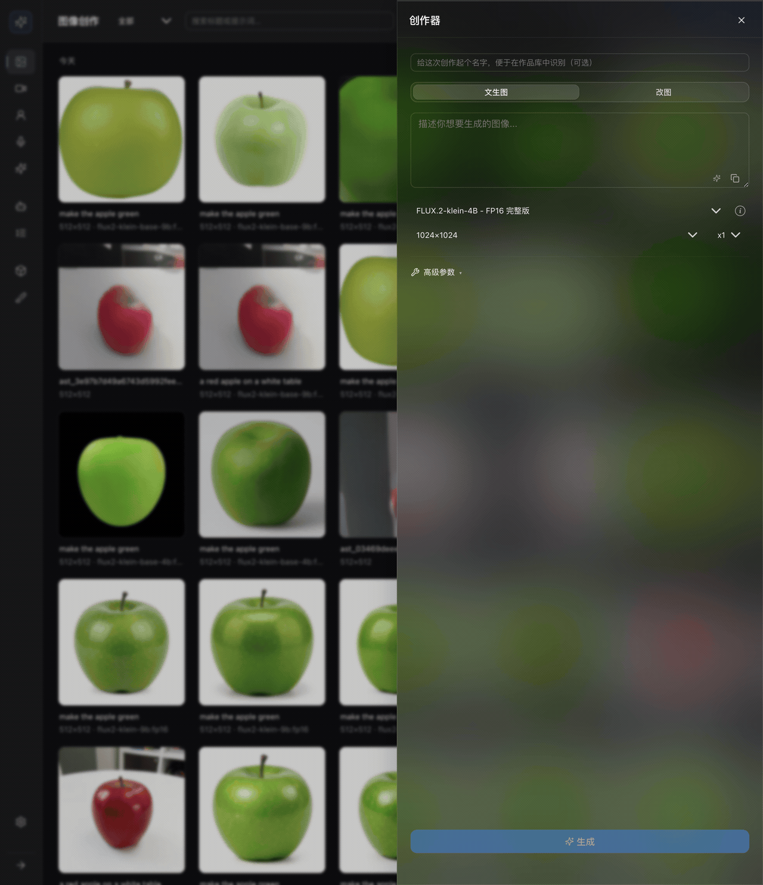
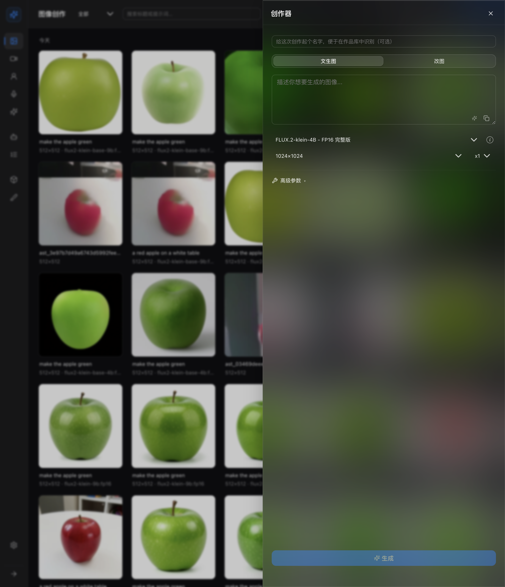
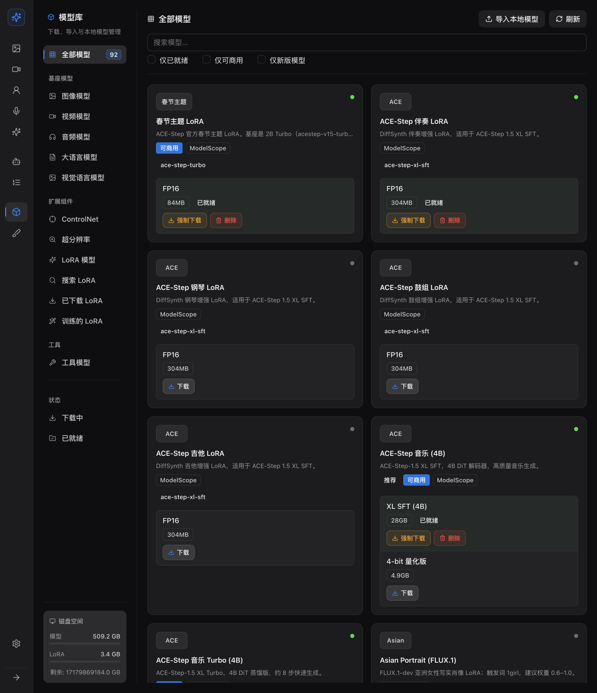
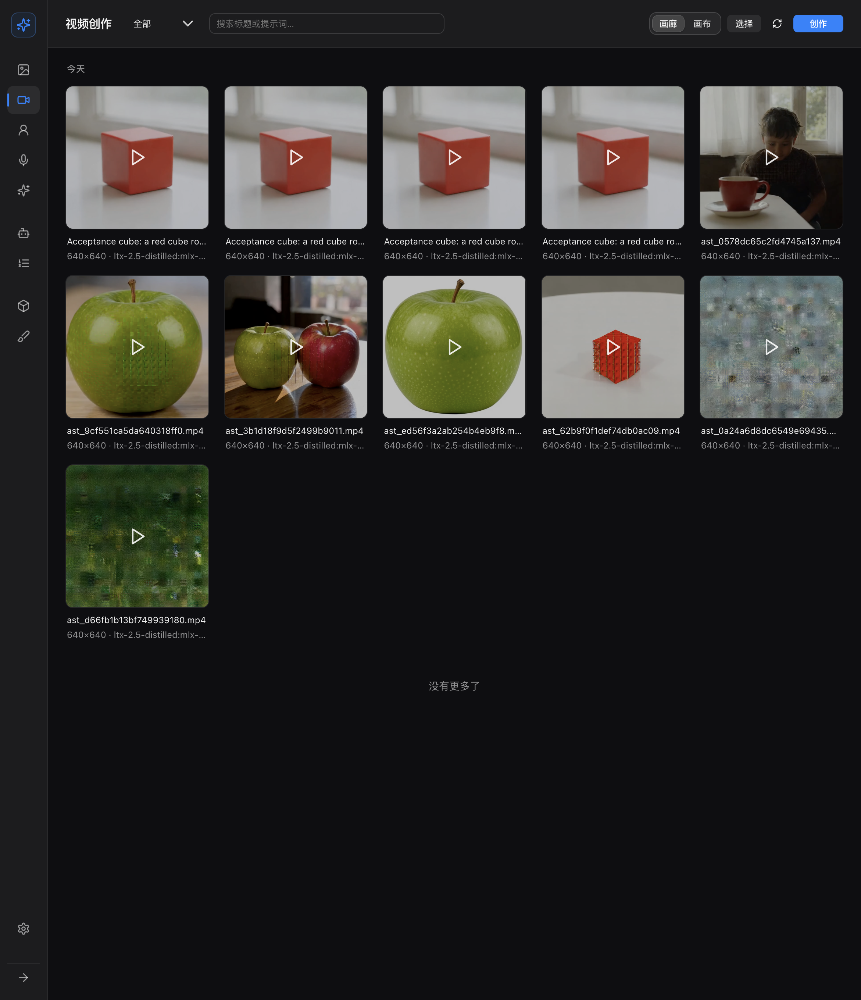

# Danmo Make

Language: [English](README.md) | **中文**

本地 **图像 / 视频 / 音频** 创作工作室——**Rust + MLX** 引擎、**Vue 3** 界面、注册表一键装模。不是节点编辑器：打开应用、选模型卡片、直接创作。权重为 **safetensors**（`fp16` / `mlx-q4` / `mlx-q8` 等，按 checkpoint dtype 加载）。缺能力 **显式失败**。



产品界面实拍（2026-11-19）— 创作器 · 画廊 · 画布 · 视频 · 模型库 · 音频

|                                                                |                                                        |
| :------------------------------------------------------------: | :----------------------------------------------------: |
|     |  |
|  |                                                        |

产品名：**Danmo Make**。运行时标识仍是 `danqing-`*；命令行工具为 `danmo-`*（见 [AGENTS.md](AGENTS.md)）。

---

## 为什么选择 Rust MLX（对比 Python MLX 与 ComfyUI）

 **Rust 原生引擎**（`danqing-api`、`danmo-`* CLI → `danmo-engine` → `danmo-mlx`）在 Apple Silicon / Linux CUDA 上 **更省安装体积、更省显存、热路径更快**。

### 相对 Python MLX实测

 Apple Silicon Metal 上的 parity 观测值。

|                       | **Danmo Make（Rust MLX）**                                                   | **Python MLX**                                   |
| --------------------- | -------------------------------------------------------------------------- | ------------------------------------------------ |
| **安装与运行时**            | 单一原生二进制（`danqing-api` release **约 22MB**）；**无需** `pip` / 首启 `runtime-venv` | macOS DMG **约 318MB**；开发 `.venv` 常见 **约 1.2GB**； |
| **显存（稳态 active，同模型）** | Z-Image Turbo `mlx-q4` **768×1280**：**5.5GB**                              | **7.0GB**（**约 79%**）                             |
|                       | Z-Image `mlx-q8`：**10.0GB**                                                | **12.4GB**（**约 88%**）                            |
| **热机延迟 p50（观测）**      | Flux2 Klein 4B `mlx-q4` 文生图 **1.54s**                                      | **2.24s**（**69%**）                               |
|                       | LTX 2.5 `mlx-q4` 文生视频 **15.4s**                                            | **17.7s**（**87%**）                               |
| **进程模型**              | 单进程 **MLX 执行器**线程；可编译 VAE、可控 resident 缓存                                   | Python 解释器 + 每任务上下文，宿主侧开销更大                      |
| **训练**                | Rust MLX LoRA 训练                                                           |                                                  |

### 相对 ComfyUI：产品形态

ComfyUI 强项是 **任意节点工作流** 与 **海量自定义节点**。Danmo Make 面向 **日常量产**：图 / 视频 / 音频共用队列、画廊、无限画布与 HTTP API，无需手搓 checkpoint 目录。

| | **Danmo Make（Rust MLX）** | **ComfyUI** |
|---|---|---|
| **目标用户** | 要 **成品工作室**（桌面 + Web）的创作者 | 要 **拼工作流** 的极客 / 技术美术 |
| **体验** | 创作器、双语模型库、全局队列、SSE 任务日志 | 节点画布；体验取决于 workflow JSON |
| **装模型** | 注册表卡片 → 下载安装 → 开跑 | 手动目录 + 常为每个家族单独装 custom nodes |
| **多模态** | 图 / 视频 / 音频 / LoRA **同一应用** | 可行，但需自建并长期维护图 |
| **资产** | SQLite 图库、无限画布、谱系边 | 多为散装文件夹 |
| **Apple Silicon** | 进程内 **MLX Metal** | 常见 **PyTorch MPS/CUDA** 或远程 GPU |
| **开放度** | 注册表动作（`create` / `rewrite` …），未支持则 fail loud | **第三方节点生态最广** |

**选 ComfyUI**：你必须用某套社区 workflow 或实验节点，而 Danmo 尚未收录。**选 Danmo Make**：你要 MLX 原生性能、更小安装包，以及已与矩阵收口对齐的家族（Z-Image、Flux2 Klein、ACE-Step、LTX 2.5 — [迁移矩阵](docs/rust_mlx_migration_matrix.json)）。

| | |
|---|---|
| **贡献者 / Coding Agent** | [AGENTS.md](AGENTS.md) |
| **桌面版（Tauri 2）** | [desktop/README.md](desktop/README.md) |
| **引擎架构** | [docs/engine_architecture.md](docs/engine_architecture.md) |
| **迁移矩阵（按模型）** | [docs/rust_mlx_migration_matrix.json](docs/rust_mlx_migration_matrix.json) · [待办](docs/rust_mlx_migration_todo.md) |
| **发布包** | [GitHub Releases](https://github.com/danmo-ai/danmo-make/releases) |

---

## 特性

- **MLX 运行时** — 单进程内一条长生命周期 MLX 执行器线程；`Array` / `Device` / `Stream` 线程亲和。Metal 与 CUDA 为不同构建产物（`mlx-metal`、`mlx-cuda`）。
- **Safetensors 权重** — 稠密张量保持 checkpoint dtype；int4/int8 仿射权重在 `LinearWeight` 内保持 packed。LoRA 为共享残差（`y = Wx + scale·BAx`）。
- **模型族** — Z-Image（含 ControlNet union）、Flux2 Klein 图像 create/rewrite 已在 Metal 收口；ACE-Step 音频 create/cover/repaint/lego/extract/complete；LTX 2.5 两阶段音视频真实跑通。状态见 [迁移矩阵](docs/rust_mlx_migration_matrix.json)；未建成的能力显式失败。
- **契约 API** — Vue 调 `danqing-api`（`POST /api/images/generations` 及同族路由）。
- **CLI** — `danmo-generate` / `danmo-edit` / `danmo-audio-`* / `danmo-video-`* 不经 HTTP 服务器，共用注册表解析与引擎路径。
- **LoRA 训练（进行中）** — Rust MLX trainer 与预设；全部门禁前为探测环。无 Python trainer。
- **全局单队列** — 图像 / 视频 / 音频串行；SSE 进度、优先级、持久化日志。
- **Studio UI** — Vue 3 + Vite + TypeScript + `@danqing/dq-ui`；创作 / 图库 / 模型 / 设置；双语注册表。
- **无限画布** — 画廊与画布共用资产库；会话、谱系边、落点、创作器绑定。
- **桌面发布** — macOS `.dmg`；Linux 桌面 / 服务端 tar.gz（`mlx-cuda`）。

---

## 环境要求

| 平台 | 说明 |
|------|------|
| **macOS（Apple Silicon）** | MLX Metal（`mlx-metal`） |
| **Linux** | MLX CUDA（`mlx-cuda`；仅编译需 CUDA toolkit） |
| **Rust** | stable（`rustup`） |
| **内存** | 大模型建议 32 GB+ |
| **Node.js** | 前端与桌面打包 |

缺后端或不支持的 action **明确报错**，不做静默兼容回退。

---

## 安装发布包（推荐）

从 [GitHub Releases](https://github.com/danmo-ai/danmo-make/releases) 下载。Windows 包暂不提供。

### macOS（Apple Silicon）— `.dmg`

1. 打开 DMG，将 **Danmo Make.app** 拖入「应用程序」。
2. 首次打开可能被拦截（未公证 / 隔离属性）。可用 **按住 Control 点按 → 打开**，或：

```bash
xattr -dr com.apple.quarantine "/Applications/Danmo Make.app"
```

更多说明见 [desktop/README.md](desktop/README.md) →「已损坏，无法打开」。

### Linux（x86_64 + NVIDIA）— thin 服务端 `.tar.gz`

CI 产物为 `danmo-make-linux-mlx-cuda-x86_64-<version>.tar.gz`（无头 `danqing-api` + 已构建界面，`mlx-cuda`）。`./run.sh` 启动二进制。

```bash
tar -xzf danmo-make-linux-mlx-cuda-x86_64-*.tar.gz
cd danmo-make-linux-mlx-cuda-x86_64-*

# 可选：
# export DANQING_HTTP_HOST=0.0.0.0
# export DANQING_HTTP_PORT=7800

./run.sh
```

- 界面 / API：**http://127.0.0.1:7800** · 文档 **/docs**

Linux **桌面包**（AppImage / `.deb`）可本地打包（`make pack-linux-desktop`），**当前 CI 不挂载**。

---

## 快速开始（源码）

贡献者 / 本地开发用。普通用户请看上方 **安装发布包**。

### 安装（Web / CLI）

```bash
git clone --recurse-submodules https://github.com/danmo-ai/danmo-make.git
cd danmo-make
```

### 运行（Web）

```bash
make dev      # danqing-api (:7800) + Vite HMR (:5800)
# make start / make stop
```

- UI：**http://localhost:5800**（`/api` → :7800）
- API：**http://127.0.0.1:7800/api/system/health**

macOS 本地 API 构建：`--features metal,mlx-metal`；Linux CUDA：`--features mlx-cuda`。

### 运行（CLI）

`danmo-*` 工具不经 HTTP 服务器生成。源文件为路径；`--lora` 可为文件路径、用户 LoRA id（`{workspace}/config/user_loras.json`）或注册表卡片，可加 `:weight`。

```bash
cargo run --manifest-path native/Cargo.toml -p danmo-cli --features mlx-metal --bin danmo-generate -- \
  --model z-image-turbo --prompt "a red apple" --output out.png
```

### 开发端口（Danmo 产品线）

| 产品 | 后端 | 前端 |
|------|------|------|
| **Make（本仓库）** | 7800 | 5800 |
| Work（Teams） | 7801 | 5801 |
| Inbox（Mail） | 7802 | 5802 |

可用 `DQ_BACKEND_PORT` / `DQ_FRONTEND_PORT` 覆盖。

### 从源码打包桌面 / 服务端

```bash
make pack-macos-desktop    # .app / .dmg（mlx-metal）
make pack-linux-desktop    # AppImage / .deb（mlx-cuda；本地）
make pack-linux-server     # 无头 danqing-api + 界面（mlx-cuda）
```

Windows 桌面包未接线。详见 [desktop/README.md](desktop/README.md)。

---

## 数据布局

| 路径 | 作用 |
|------|------|
| `~/.danmo-make/` | 控制面：工作区指针、应用配置、日志、`api.port` |
| `{workspace}/config/` | 运行时注册表 / 预设（从 `default_config/` 种子） |
| `{workspace}/models/` | 权重 / LoRA |
| `{workspace}/outputs/` | 生成物 |
| `{workspace}/db/studio.db` | 任务 + 资产（SQLite WAL） |

开发（`make dev`、无指针）时媒体根可留在仓库（`./models` 等）；控制面仍为 `~/.danmo-make`。

覆盖控制面：`DANQING_USER_DATA_DIR`。

---

## Agent / MCP

这版没有 `/mcp/`，也没有 `bin/danqing-mcp`。设置里仍可以单独存一把 MCP 钥匙。Agent 走 HTTP API。本机 loopback 免密；远程要带 `Authorization: Bearer`，钥匙在 **设置 → 集成**（`DANQING_HTTP_API_KEY`）。

---

## 创作页 ↔ 模型 `actions`

标签页只列出工作区注册表中声明了对应 action 的模型。

### 图像

| 标签页 | 注册表 action | API |
|--------|---------------|-----|
| 文生图 | `create` | `POST /api/images/generations` |
| 指令 / 参考改图 | `rewrite` | `POST /api/images/edits` |
| 局部重绘 | `retouch` | `POST /api/images/edits` |
| 扩图 | `extend` | `POST /api/images/edits` |
| 放大 | `upscale` | `POST /api/images/upscales` |

注册表 `create` 对应 `POST /api/images/generations`。`rewrite`、`retouch`、`extend` 对应 `POST /api/images/edits`。

### 视频

| 标签页 | 注册表 action | API |
|--------|---------------|-----|
| 文生视频 | `create` | `POST /api/videos/generations` |
| 图生视频 | `animate` | `POST /api/videos/edits` |

LTX 2.5 两阶段音视频可真实跑通；Wan / Hunyuan / MiniMax / LongCat 等仍在迁移 — 未建成的 action 显式失败。

### 音频

| Action | API |
|--------|-----|
| 文生音乐（`create`） | `POST /api/audios/generations` |
| 翻唱 / 局部重绘 / lego / extract / complete | `POST /api/audios/edits` |

### 无限画布（摘要）

创作页 → **画布**：导入（`I`）、结果进落点（`S` 贴靠）、谱系（`E` / `Y` / `G`）。会话见 `/api/canvas/sessions`。快捷键全表见 [AGENTS.md](AGENTS.md)。

结构引导（Z-Image ControlNet union）已接线；不支持的家族带上 guide 会显式失败。

---

## 项目结构

```
danmo-make/
├── native/               # Rust：danqing-api、danmo-engine、danmo-cli、danmo-mlx
├── frontend/             # Vue 3
├── desktop/              # Tauri 2
├── default_config/       # 出厂注册表 / 预设 / 语言包
├── scripts/
├── docs/
└── out/                  # 构建产物（gitignore）
```

---

## 架构

```
Vue / danmo-* CLI
  ↓ HTTP 或直连
danqing-api / danmo-cli
  ↓ Engine 端口
Engine → Session → 共享 DiT / Facade pipeline
  ↓ families/mod.rs 工厂
Family session
  ↓ common → runtime（MLX 执行器）
danmo-mlx → danmo-mlx-sys → mlx-c → MLX C++ → Metal 或 CUDA
```

单进程一条 MLX 执行器线程；权重、编译闭包与模型缓存在此线程上。标准 DiT 阶段：resolve → load → encode → schedule → infer → decode → persist。`pipeline` / `session` / `common` / `runtime` / `weights` 不感知 family id；家族之间不互相 import。原则见 [docs/engine_architecture.md](docs/engine_architecture.md)。

---

## 发版产物（CI）

打 `v*` tag → [`.github/workflows/release.yml`](.github/workflows/release.yml)。

| 平台                  | CI 产物                                |
| ------------------- | ------------------------------------ |
| macOS Apple Silicon | `.dmg`（`mlx-metal`）                  |
| Linux x86_64        | `danmo-make-linux-mlx-cuda-*.tar.gz` |
| Windows             | `make pack-windows-sidecar`（CI 未挂载）  |

```bash
make pack-macos-desktop
make pack-linux-desktop
make pack-linux-server
make pack-ggml-sidecar     # 发布用 danqing-api sidecar（MLX feature）
```

---

## 配置

**应用设置** — 控制面 / 工作区下的 `.app_config.json`：语言、主题、默认模型、显存上限、队列策略、集成 API Key 等。

**注册表** — `default_config/models_registry.json`（`schema_version: 3`）。MLX 版本键含 `fp16`、`mlx-q4`、`mlx-q8` 等；标签不保证张量 dtype（生产按 checkpoint 加载）。

**常用环境变量**：

```bash
DANQING_HTTP_HOST=127.0.0.1
DANQING_HTTP_PORT=7800
DANQING_DB=db/studio.db
DANQING_REGISTRY=default_config/models_registry.json
DANQING_WORKSPACE=/path/to/workspace
DANQING_USER_DATA_DIR=~/.danmo-make
# 优先在「设置 → 集成」创建钥匙，而不是长期写明文：
# DANQING_HTTP_API_KEY=...
# DANQING_MCP_API_KEY=...
```

---

## 开发

| 命令 | 用途 |
|------|------|
| `make dev` / `stop` | `danqing-api` + Vite |
| `make dev-desktop` | Tauri + Vite（已有 API 时 `SKIP_BACKEND=1`） |
| `make frontend-build` | → `out/frontend/dist/` |
| `make test` | workspace `cargo test` |
| `cargo test --manifest-path native/Cargo.toml -p danmo-engine --features mlx-metal --lib` | 引擎测试（Metal） |
| `make pack-ggml-sidecar` | 发布用 `danqing-api` sidecar（MLX） |
| `make clean` | `cargo clean` 并清掉 `out/` |

---

## API 概览

| 领域 | 端点 |
|------|------|
| 图像 | `POST /api/images/generations` \| `edits` \| `upscales` |
| 视频 | `POST /api/videos/generations` \| `edits` \| `upscales` |
| 音频 | `POST /api/audios/generations` \| `edits` |
| 任务 | `GET/PATCH/DELETE /api/tasks/{id}`，SSE `…/stream`，`…/diagnose` |
| 资产 / 画布 | `/api/assets`，`/api/canvas/sessions` |
| 模型 | `/api/models`，`/api/registry` |
| 系统 | `/api/system/health`，`/api/settings/*` |

交互文档：**http://localhost:7800/docs**

---

## 许可证

MIT
